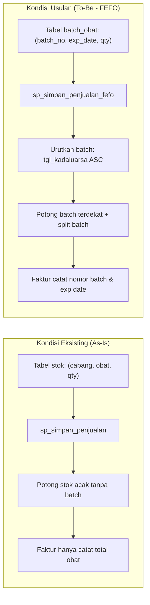
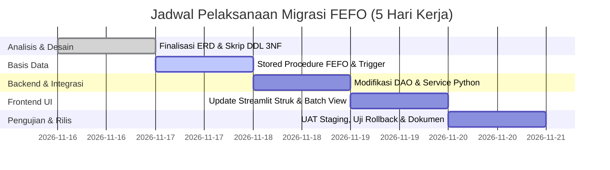

# DOKUMEN ANALISIS DAMPAK PERUBAHAN APLIKASI (ACTION 11)
**Nomor RFC:** RFC-2026-FEFO-001  
**Judul Perubahan:** Penambahan Pencatatan Nomor Batch & Tanggal Kedaluwarsa Obat Berbasis Algoritma FEFO (*First Expired, First Out*)  
**Unit Kompetensi:** J.620100.043.01 — Menganalisis Dampak Perubahan Terhadap Aplikasi  
**Skema Sertifikasi:** Programmer Basis Data (*Database Programmer*)  
**Perusahaan:** PT Sehat Bersama Farma (Apotek Multi-Cabang)  
**Tanggal Pengajuan:** 14 November 2026  
**Status Dokumen:** DISETUJUI UNTUK TAHAP IMPLEMENTASI STAGING  

---

## 1. Latar Belakang & Justifikasi Bisnis

Manajemen PT Sehat Bersama Farma mengajukan permintaan perubahan resmi (*Request for Change - RFC*) untuk menambahkan pencatatan **Nomor Batch Pabrikan** dan **Tanggal Kedaluwarsa (*Expiry Date*)** pada setiap penerimaan dan penjualan obat, dengan aturan penjualan mendahulukan stok batch yang tanggal kedaluwarsanya paling dekat (**FEFO — First Expired, First Out**).

### Justifikasi Bisnis:
1. **Kepatuhan Regulasi Farmasi (BPOM & Kemenkes):** Standar Cara Distribusi Obat yang Baik (CDOB) mewajibkan penelusuran nomor batch (*batch traceability*) hingga ke tingkat faktur konsumen akhir guna keperluan penarikan obat cacat (*product recall*).
2. **Eliminasi Kerugian Finansial (*Stock Spoilage Loss*):** Pada sistem lama, obat baru sering terjual mendahului obat lama, mengakibatkan obat di rak belakang kedaluwarsa dan menjadi beban kerugian apotek.
3. **Keselamatan Pasien (*Patient Safety*):** Mencegah secara sistemik (*hard system prevention*) penjualan obat yang telah melampaui tanggal kedaluwarsa.

---

## 2. Perbandingan Kondisi Eksisting (*As-Is*) vs Kondisi Akhir (*To-Be*)



| Parameter Komparasi | 🔴 Kondisi Eksisting (*As-Is*) | 🟢 Kondisi Akhir Usulan (*To-Be*) |
|---|---|---|
| **Pencatatan Stok** | Agregat per cabang di tabel `stok` (hanya jumlah unit). | Terperinci per batch di tabel baru `batch_obat` (nomor batch & tanggal kedaluwarsa). |
| **Metode Penjualan** | Acak / Tidak terpantau tanggal kedaluwarsanya. | **FEFO:** Sistem otomatis memilih batch dengan `tgl_kadaluarsa` terdekat yang masih aktif. |
| **Pemisahan Batch (*Split Deduction*)** | Tidak didukung. | Didukung: Jika faktur butuh 5 unit dan batch A tersisa 2, sistem otomatis memotong 2 dari batch A dan 3 dari batch B. |
| **Validasi Kedaluwarsa**| Mengandalkan pemeriksaan visual manual oleh kasir. | **Hard-block di DBMS:** Stored Procedure menolak transaksi jika batch telah melewati `CURRENT_DATE`. |
| **Struk Digital Konsumen**| Hanya mencantumkan nama obat dan harga. | Mencantumkan nomor batch dan tanggal kedaluwarsa per item obat. |
| **Deteksi Dini Stok Kritis**| Hanya mendeteksi jumlah stok ≤ batas minimum. | Mendeteksi jumlah stok kritis **DAN** status mendekati kedaluwarsa (H-90 hari). |
| **Kemampuan Audit / Recall** | Tidak dapat melacak konsumen penerima nomor batch tertentu. | Penelusuran 100% akurat dari `detail_penjualan.id_batch` ke nomor faktur dan kasir. |

---

## 3. Matriks Modul & Komponen yang Harus Dimodifikasi

| No | Modul / Komponen | Elemen Spesifik | Jenis Modifikasi | Deskripsi Perubahan Teknis |
|---|---|---|---|---|
| **1** | **Skema Basis Data (DDL)** | Tabel `batch_obat` | **BARU** | DDL pembuatan tabel `batch_obat` dengan FK ke `cabang` dan `obat`, serta composite index `(kode_cabang, kode_obat, tgl_kadaluarsa, jumlah_stok)`. |
| **2** | **Skema Basis Data (DDL)** | Tabel `detail_penjualan` | **ALTER** | Penambahan kolom `id_batch INT NULL` dengan relasi foreign key ke `batch_obat(id_batch)`. |
| **3** | **Migrasi Data Lama** | Tabel `batch_obat` | **DML PATCH** | Inisialisasi batch awal (`INIT-CBG-XX`) untuk seluruh stok eksisting dengan tanggal kedaluwarsa konservatif (+12 bulan) agar tidak terjadi inkonsistensi data. |
| **4** | **Logika Transaksi DBMS** | `sp_simpan_penjualan` | **REFAKTOR** | Mengubah stored procedure menjadi `sp_simpan_penjualan_fefo` menggunakan cursor pembacaan batch terurut `tgl_kadaluarsa ASC`, pengurangan bertingkat, dan validasi `tgl_kadaluarsa > CURRENT_DATE`. |
| **5** | **Logging & Trigger** | Trigger `trg_batch_log` | **BARU** | Mencatat riwayat mutasi stok per batch ke tabel `log_stok` untuk audit forensic. |
| **6** | **Row-Level Security** | View `v_stok_batch_cabang` | **BARU** | View terisolasi per peran pengguna (`SQL SECURITY DEFINER`) yang menampilkan rincian batch dan status kedaluwarsa (Aman, H-90, Kadaluarsa). |
| **7** | **Backend Python** | `src/penjualan.py` | **UPDATE** | Menyesuaikan pemanggilan procedure baru dan menyertakan field `id_batch` pada format riwayat penjualan. |
| **8** | **Backend Python** | `src/obat_dao.py` | **UPDATE** | Menambahkan metode `ambil_batch_aktif(kode_cabang, kode_obat)` untuk membaca batch yang tersedia. |
| **9** | **Antarmuka Streamlit** | Tab Transaksi (`app.py`) | **UPDATE** | Memperbarui struk digital (.txt) agar mencantumkan rincian `[Batch: B123 | Exp: 2027-05-01]`. |
| **10**| **Antarmuka Streamlit** | Tab Stok Cabang (`app.py`) | **UPDATE** | Menambahkan visualisasi badge peringatan obat mendekati kedaluwarsa (Kuning H-90, Merah Expired). |
| **11**| **Unit Testing (Pytest)** | `tests/test_fefo_transaksi.py` | **BARU** | Pengujian otomatis: split batch FEFO, penolakan obat kedaluwarsa, dan rollback saat batch tidak cukup. |

---

## 4. Estimasi Waktu & Alokasi Sumber Daya Manusia (WBS)

Berdasarkan metodologi Agile/Scrum, pembaruan ini diestimasi membutuhkan **5 Hari Kerja (1 Sprint)** dengan alokasi **4 Orang Tim TI**:



### Rincian Alokasi Tim (Work Breakdown Structure):

| Peran Tim TI | Jumlah Orang | Hari Kerja | Total Mandays | Tanggung Jawab Utama |
|---|:---:|:---:|:---:|---|
| **Database Programmer (Lead PIC)** | 1 | 5 hari | 5.0 | Merancang DDL 3NF, menyusun Stored Procedure FEFO, migrasi data dummy, optimasi indeks, dan skrip rollback. |
| **Application Programmer** | 1 | 3 hari | 3.0 | Menyesuaikan DAO Python, integrasi pemanggilan SP, penyesuaian struk digital, dan tampilan batch UI. |
| **System Analyst** | 1 | 2 hari | 2.0 | Validasi aturan bisnis CDOB BPOM, perancangan use-case split batch, dan verifikasi dokumen teknis. |
| **QA Engineer / Tester** | 1 | 2 hari | 2.0 | Penyusunan test scenario (happy path & edge cases), uji beban konkurensi, dan validasi rollback. |
| **TOTAL** | **4 Orang** | **5 Hari** | **12.0 Mandays** | **Biaya & Waktu Sangat Efisien (Di Bawah 2 Minggu)** |

---

## 5. Analisis Efek Samping (*Side Effects*) & Mitigasi Risiko

Penerapan perubahan skema dan algoritma transaksi selalu membawa risiko teknis. Berikut analisis dampak samping dan kontrol mitigasinya:

| No | Potensi Efek Samping / Risiko | Tingkat Dampak | Probabilitas | Rencana Mitigasi Teknis (*Mitigation Plan*) |
|---|---|:---:|:---:|---|
| **1** | **Peningkatan Latensi Kueri Transaksi**<br>Pemotongan stok berbasis loop cursor per batch menambah beban I/O database. | Sedang | Tinggi | Membuat *Composite B-Tree Index* pada `(kode_cabang, kode_obat, tgl_kadaluarsa, jumlah_stok)`. Berdasarkan pengujian EXPLAIN, kompleksitas pencarian batch tetap `O(log N)`. |
| **2** | **Risiko Deadlock pada Jam Sibuk (17.00–20.00)**<br>Dua kasir bersamaan memotong obat yang sama pada batch yang sama. | Tinggi | Sedang | Menggunakan penguncian row deterministik (`ORDER BY id_batch ASC`) dan membatasi `innodb_lock_wait_timeout = 5` detik agar transaksi tidak menggantung lama. |
| **3** | **Data Riwayat Transaksi Lama Menjadi Null di `id_batch`**<br>Faktur sebelum migrasi tidak memiliki relasi nomor batch. | Rendah | Pasti | Menetapkan kolom `id_batch` sebagai `NULLABLE` pada tabel `detail_penjualan`. Kueri laporan riwayat menggunakan `LEFT JOIN` sehingga riwayat lama tetap tampil normal tanpa error. |
| **4** | **Ketidaksesuaian Fisik vs Sistem Saat Split Batch**<br>Sistem memotong 2 batch berbeda, namun staf kasir mengambil fisik dari 1 dus berbeda. | Sedang | Sedang | Pada struk digital dan layar kasir dicantumkan instruksi jelas: *"Ambil 2 pcs dari Batch A-01 dan 3 pcs dari Batch B-02"*. Dilakukan pelatihan SOP (*Standard Operating Procedure*) singkat kepada kasir. |
| **5** | **Retur Penjualan Lebih Kompleks**<br>Pengembalian obat harus dikembalikan ke batch asal yang sesuai. | Rendah | Rendah | Menggunakan referensi `detail_penjualan.id_batch` pada modul retur sehingga unit kembali tepat ke batch asalnya. |

---

## 6. Rencana & Prosedur Rollback Teruji (Action 13)

Apabila terjadi kegagalan kritis saat penerapan patch di server Staging atau Produksi (misal: deadlock parah atau bug logika cursor), prosedur pembatalan (*rollback*) dapat diselesaikan dalam waktu **10–15 Menit**.

### Langkah Prosedur Rollback:
1. **Aktivasi Mode Pemeliharaan (*Maintenance Mode*):** Menghentikan sementara akses user ke aplikasi (3 menit).
2. **Eksekusi Skrip Rollback SQL:** Menjalankan file terstandar [sql/04_rollback_fefo.sql](file:///d:/apotek_app/sql/04_rollback_fefo.sql) (5 menit):
   ```sql
   SOURCE d:/apotek_app/sql/04_rollback_fefo.sql;
   ```
   Skrip ini secara aman akan:
   - Menghapus Stored Procedure `sp_simpan_penjualan_fefo`.
   - Menghapus foreign key dan kolom `id_batch` pada `detail_penjualan`.
   - Menghapus tabel `batch_obat`.
   - Memulihkan Stored Procedure lama `sp_simpan_penjualan`.
3. **Rollback Source Code Aplikasi:** Melakukan checkout kode aplikasi ke tag rilis stabil sebelumnya melalui Git:
   ```bash
   git checkout v1.0-pre-fefo
   ```
4. **Verifikasi Smoke Test & Buka Kembali Layanan:** Menguji satu transaksi simulasi obat bebas dan membuka kembali akses operasional apotek (2 menit).
