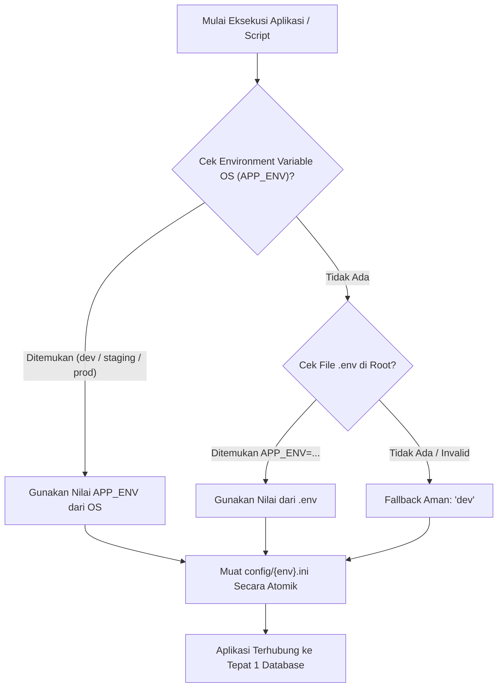

# DOKUMEN SPESIFIKASI & PANDUAN KONFIGURASI MULTI-ENVIRONMENT
**Proyek:** Sistem Inventori & Penjualan Apotek Multi-Cabang  
**Perusahaan:** PT Sehat Bersama Farma  
**Skema Sertifikasi:** Programmer Basis Data (*Database Programmer*)  
**Unit Kompetensi:** J.620100.042.01 — Melaksanakan Konfigurasi Perangkat Lunak Sesuai Environment (Development, Staging, Production)

---

## 1. Identifikasi Kebutuhan & Spesifikasi Environment

Dalam pengembangan sistem basis data berskala enterprise multi-cabang, pemisahan lingkungan (*environment isolation*) merupakan kontrol wajib sesuai standar **SNI ISO/IEC 27001 (A.12.1.2 — Pemisahan Fasilitas Pengembangan, Pengujian, dan Operasional)** serta **The Twelve-Factor App (Faktor III: Konfigurasi)**.

### Matriks Perbandingan Spesifikasi Ketiga Environment

| Komponen / Parameter | 🛠️ Development (DEV) | 🧪 Staging (STAGING) | 🚀 Production (PROD) |
|---|---|---|---|
| **Tujuan Utama** | Pengkodean fitur baru, debugging stored procedure, optimasi kueri lokal | Uji coba integrasi, simulasi migrasi patch/DDL, UAT, evaluasi asesmen | Melayani operasional live transaksi 5 cabang apotek 24/7 |
| **Target Host** | `localhost` / `127.0.0.1` | `localhost` (simulasi uji) / Server VPC Staging | Server Database Cluster Internal / IP Private |
| **Port DBMS** | `3306` | `3306` (atau isolated port staging) | `3306` (firewall whitelisted) |
| **Nama Basis Data** | `apotek` | `apotek_staging` | `apotek_prod` |
| **Karakteristik Data** | Data dummy / mock contoh (10 obat, 3 cabang, 5 transaksi) | Salinan data ter-anonimisasi dari snapshot produksi | Data transaksi riil seluruh cabang (±2.500 obat, ±1.200 trx/hari) |
| **Akun & Hak Akses** | Akun developer lokal (`admin.pusat`, `kasir.depok`, dll.) | Akun QA / Auditor / Asesor dengan kata sandi pengujian | Akun *Least Privilege* dengan kata sandi kuat unik dari Secret Vault |
| **Level Logging** | `DEBUG` (Sangat verbose, mencatat detail tracing & payload) | `INFO` (Mencatat alur event transaksi, waktu proses, dan user event) | `WARNING` / `ERROR` (Hanya mencatat anomali, pelanggaran batas, & failure) |
| **Enkripsi In-Transit** | Non-TLS (loopback internal, prioritas kecepatan dev) | TLS/SSL direkomendasikan | **WAJIB TLS/SSL** (`ca-cert.pem`, mitigasi ancaman Man-in-the-Middle) |
| **Kebijakan Demo Mode**| `true` (Menampilkan daftar akun demo di halaman login) | `true` (Mempermudah verifikasi asesi/auditor) | `false` (DILARANG KERAS di lingkungan produksi) |
| **Batas Timeout Koneksi**| Connect: 5s, Read: 10s | Connect: 5s, Read: 10s | Connect: 3s, Read: 5s (Fail-fast strategy) |
| **Kapasitas Koneksi** | Max 20 koneksi | Max 50 koneksi | Max 150 koneksi (dengan Connection Pooling) |
| **Ambang Latensi Kueri**| Warning: >150 ms, Kritis: >400 ms | Warning: >100 ms, Kritis: >300 ms | Warning: >50 ms, Kritis: >200 ms |

---

## 2. Arsitektur Pemisahan Konfigurasi (Best Practice)

### A. Prinsip "Strict Separation of Config and Code"
1. **Tidak Ada Hardcoding:** Parameter host, nama database, dan level log **dilarang keras** ditulis langsung di dalam source code Python (`app.py`, `koneksi.py`, dll.).
2. **Penyimpanan Profil `.ini` Terstruktur:**
   - [config/dev.ini](file:///d:/apotek_app/config/dev.ini) memuat profil arsitektur Development.
   - [config/staging.ini](file:///d:/apotek_app/config/staging.ini) memuat profil arsitektur Staging.
   - [config/prod.ini](file:///d:/apotek_app/config/prod.ini) memuat profil arsitektur Production.
3. **Pemisahan Kredensial Sensitif:**
   - Password dan secret key **tidak pernah di-commit ke Git**. File `.env` masuk ke `.gitignore`.
   - File template `.env.example` disediakan sebagai acuan struktur variabel lingkungan.

---

## 3. Mekanisme Aktivasi Satu Environment pada Satu Waktu (Single Active Environment)

Aplikasi menerapkan aturan ketat: **Hanya satu environment yang aktif dalam satu sesi eksekusi** (*Single Active Environment Principle*). Hal ini mencegah bencana kontaminasi silang (*cross-environment data corruption*), seperti developer tidak sengaja menjalankan script pengujian lokal ke database produksi.

### Hierarki Resolusi Environment:


### Alat CLI Pengelola Environment (`manage_env.py`):
Tersedia utility CLI resmi untuk memantau, memvalidasi, dan mengalihkan environment secara instan:

```bash
# 1. Menampilkan status environment yang sedang aktif beserta matriks spesifikasi
python manage_env.py status

# 2. Mengalihkan environment secara atomik ke Staging
python manage_env.py set staging

# 3. Mengalihkan environment ke Production
python manage_env.py set prod

# 4. Mengembalikan ke Development
python manage_env.py set dev

# 5. Melakukan validasi kelengkapan seluruh file konfigurasi
python manage_env.py validate

# 6. Menguji koneksi langsung ke target basis data yang sedang aktif
python manage_env.py test-conn
```

---

## 4. Strategi Logging Berdasarkan Level Risiko (Action 2, 10, 14)

Penerapan tingkatan log (*Logging Levels*) disesuaikan secara proporsional dengan risiko dan performa setiap environment:

- **DEV (`DEBUG`):**
  Mencatat setiap detail kueri SQL, waktu pembentukan payload JSON Stored Procedure, parameter prepared statement, dan full traceback exception. Sangat krusial bagi programmer saat merekayasa modul atau mencari bug.
- **STAGING (`INFO`):**
  Mencatat siklus hidup autentikasi pengguna, nomor faktur yang berhasil diterbitkan, transaksi yang di-rollback oleh Stored Procedure, dan durasi eksekusi migrasi patch DDL. Berguna untuk analisis kelayakan rilis sebelum naik ke produksi.
- **PROD (`WARNING`):**
  Hanya mencatat kejadian yang berpotensi menimbulkan gangguan operasional, seperti koneksi database mencapai ambang batas 90%, latensi kueri melampaui 200 ms, atau kegagalan transaksi berulang yang mengindikasikan serangan / bug kritis. Strategi ini meminimalkan overhead Disk I/O dan melindungi privasi data transaksi audit.
